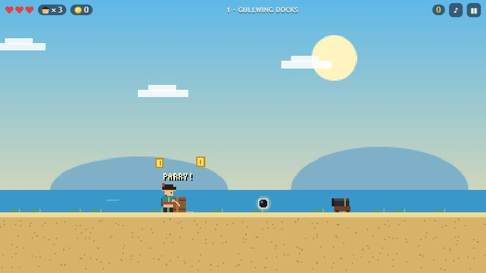
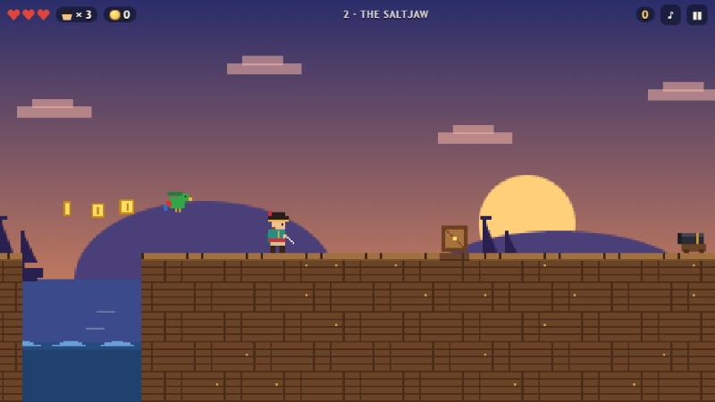
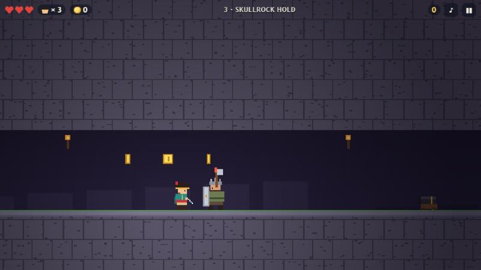
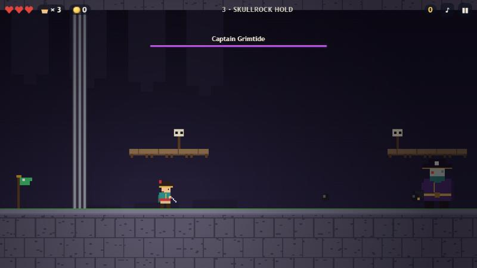
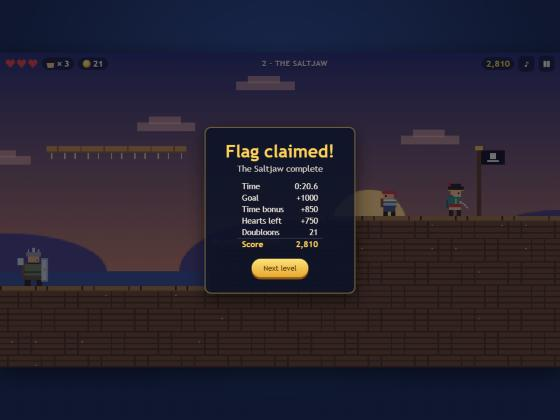
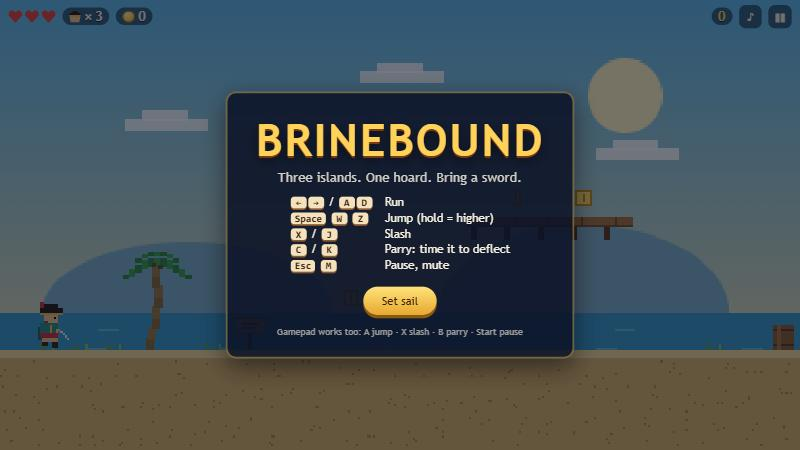
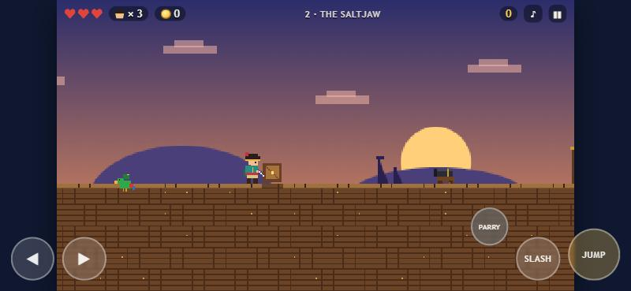
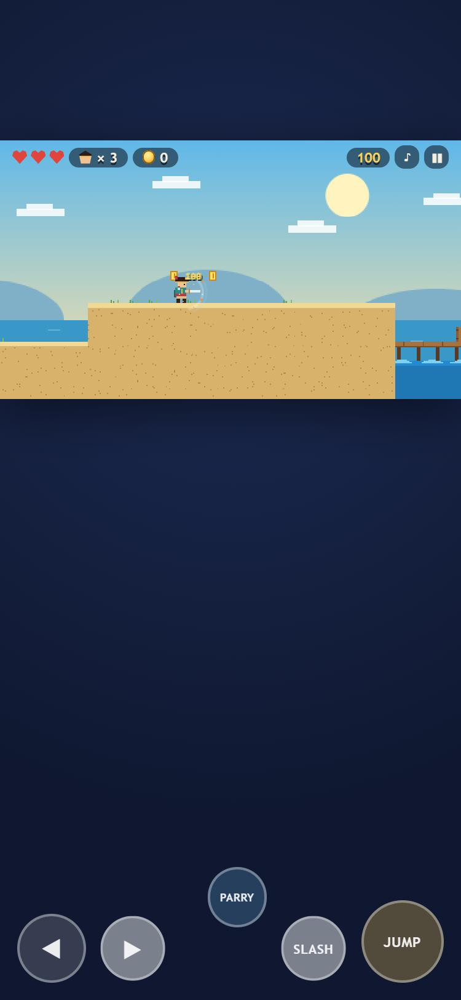

# Brinebound

[](https://github.com/wallaceandrew9331-create/pirate-platformer/actions/workflows/ci.yml)

**[▶ Play it in your browser](https://wallaceandrew9331-create.github.io/pirate-platformer/)**. Works on desktop, with a gamepad, and on phones.

An original pirate side-scroller. Run, jump and fight your way across three islands to the treasure at the bottom of Skullrock Hold. Each enemy needs a different answer: stomp the deckhands, dodge the parrots, parry the cannonballs back where they came from, and get behind the shielded brutes. At the end, Captain Grimtide is waiting.

The game is a **deterministic, fixed-step simulation** in plain TypeScript with no DOM access, drawn on a Canvas 2D at 384×216 and scaled up pixel-perfect. Everything is made in code: the pixel art is `fillRect` calls, and every sound and the music are synthesised with WebAudio. There are no asset files at all. Because the sim is pure, a **beam-search solver** can play every level headless in Node. CI runs it, so a level edit that adds an impossible jump fails the build.



| | |
|---|---|
|  |  |
|  |  |
|  |  |



## How to play

Five buttons, that's all:

| Action | Keyboard | Gamepad | Touch |
|---|---|---|---|
| Run | ← → or A D | d-pad / left stick | ◀ ▶ |
| Jump (hold for higher) | Space, W, Z or ↑ | A | JUMP |
| Slash | X or J | X or Y | SLASH |
| Parry | C or K | B or a bumper | PARRY |
| Pause / mute | Esc or P / M | Start | ❚❚ / ♪ |

**The enemies**

| Foe | What works |
|---|---|
| **Deckhand**: patrols back and forth | Stomp it or slash it. Touching it hurts. |
| **Parrot**: perches, squawks, then dives at where you *were* | It can't be beaten. Move after the squawk to dodge, or slash it to bat it away for a while. Landing on it hurts. |
| **Cannon**: fires along the deck when you're in range | Iron: a sword just clangs off it. Parry a ball as it arrives and it flies back and smashes the cannon. Crates make good cover. |
| **Brute**: big shield in front, slow to turn round | Slashes from the front are blocked and a stomp only bounces off the spiked helmet. Jump over and strike from behind before he turns, or parry his axe swing to stun him and riposte. |
| **Captain Grimtide** (boss) | Alternates cannon volleys (parry them back for damage) with shoulder charges. Jump the charge and he slams into the wall, stunned: two free hits. Six to win. |

**Also:** doubloons (100 = an extra life), crates you can slash or head-butt open for 3 doubloons, springy barrels, checkpoint flags, 3 hearts and 3 lives. Finishing a level pays a goal bonus, a bonus for each heart left and a time bonus under par.

**The levels**

1. **Gullwing Docks**: beach and piers, with a signpost tutorial that introduces each enemy one at a time.
2. **The Saltjaw**: a fleet at sunset. Ship decks and rigging over open sea, springs, cannons behind crate cover.
3. **Skullrock Hold**: a torch-lit sea cave with spike pits and stepping-stone pillars, then the boss arena.

## Running it

Needs Node 22+.

```bash
npm install
```

```bash
npm run dev
```

That serves the game at http://localhost:5200 (also on your LAN IP, so you can try it on a phone).

```bash
npm test
```

That runs 55 Vitest tests: collision and the player controller, every combat rule, level data checks, determinism, and the solver beating all three levels (about a minute).

```bash
npm run lint && npm run typecheck && npm run build
```

```bash
npm run solve
```

That runs the full-width solver on every level and prints how it did (`-- 3` for one level, `--save` to write its inputs to `tools/out/` for replaying in a dev build).

## How it's built

```
src/game/          the simulation: pure TypeScript, no DOM, no clock, no randomness
  constants.ts       every tuning number in one place
  tiles.ts           tile codes and grid lookup
  physics.ts         axis-separated AABB vs tile collision, one-way platforms
  player.ts          run, jump (coyote time, buffer, variable height), slash, parry
  combat.ts          the combat rules as small pure functions
  enemies.ts         one state machine per enemy kind, plus the boss
  world.ts           one fixed step: player, enemies, balls, hits, pickups, death, respawn
  level.ts           ASCII level format and parser
  levels/*.ts        the three levels, as tile grids
  solver.ts          beam-search player used by tests and tools
src/ui/            the presentation
  render.ts          Canvas 2D: tiles, parallax backgrounds, particles, screen shake
  sprites.ts         pixel-art characters drawn with fillRect
  pixelfont.ts       3×5 pixel font for in-world popups
  input.ts           keyboard, gamepad and multi-touch buttons → one 5-button input
  audio.ts           WebAudio sound effects and a small music sequencer
src/main.ts        screens, the fixed-timestep loop, HUD
tools/
  levels-src.py      authoring helper: levels drawn as side-by-side chunks
  solve.ts           CLI around the solver
```

### Design notes

**Feel first.** The controller has the standard platformer forgiveness: 0.1 s of coyote time after running off a ledge, a 0.12 s jump buffer so a press just before landing still jumps, and variable jump height (two gravities: lighter while rising with jump held, heavier when falling or after release, plus a cut to 42% of upward speed when you let go early). A full jump clears three tiles, never four, and the level tests check that number. Facing is locked mid-swing, and bracing a parry plants your feet, so attacks commit you a little.

**Every enemy asks a different question.** Combat was designed backwards from the button count: with only slash and parry, each foe has to make you choose. Deckhands are free points for either answer. Parrots punish standing still and can't be farmed. Cannons can only be answered with a parry. Brutes force positioning (go round) or timing (parry the telegraphed swing). The boss combines the last two. Each rule is a small pure function in `combat.ts` (`slashOutcome`, `stompOutcome`, `ballVsPlayer`, `bruteSwingOutcome`...) with its own unit test. A successful parry refunds its cooldown and ends the brace immediately, so a good read leads straight into a riposte.

**Fixed timestep, pure sim.** The sim advances in exact 1/60 s steps, and the render loop runs those steps from an accumulator, so physics is identical at 30, 60 or 144 Hz. The sim never reads the clock, the DOM or `Math.random` (an ESLint rule enforces it). Per-step movement is under one tile, so axis-separated collision never tunnels. One-way platforms only catch a body whose feet were above the plank before the move. The sim reports what happened as events (`jump`, `parry`, `kill`, `thud`...) that the renderer turns into particles and screen shake and the audio turns into sound, so neither leaks back into the rules.

**A solver as a level test.** Hand-checking that three levels are beatable after every tweak doesn't scale. `solver.ts` runs a beam search over 15 macro-actions (run, jump tap or hold, slash, parry, each held for 6 frames). States are cloned with `structuredClone` and deduplicated on quantised position, velocity, hearts and boss HP. Fitness is progress, with a large bonus for boss damage once the arena locks. It finds a route through every level in seconds to a minute, including parrying the boss's cannonballs, and a test replays the winning inputs to confirm the run reproduces exactly. The solver is a frame-perfect player that never pauses, so its times (about 20 to 27 s) are far under the par times (95 to 150 s) that set the time bonus.

**Levels are data.** Each level is a 15-row ASCII grid: `#` ground, `=` one-way planks, `^` spikes, `~` water, `x` crates, `J` springs, letters for enemies, `C` checkpoints, `S` signposts with tutorial text, `|` the boss gate. Data tests check that every row is the same width, that spawns stand on solid ground, and that all four enemy kinds appear.

**Playtesting.** Dev builds expose `window.__brine` with `start(level)`, `replay(level)` (plays back a solver recording) and `advance(seconds, input)`, which steps the game synchronously. The screenshots above were staged with it. Things it caught:

| Problem found | Change |
|---|---|
| The solver beat the boss with four slashes in a single stun. | At most two sword hits per stun, then he shakes it off. |
| After parrying a brute you couldn't riposte: the parry pose was still locking out the slash. | A clean parry ends the brace at once. |
| In the touch playtest, a press was dropped whenever `setPointerCapture` threw. | The press is registered first; capture is best-effort. |
| Cannonballs vanished against the dark cave walls. | Balls get a pale rim. |
| Canvas text for "PARRY!" and scores came out blurry once scaled up. | A 3×5 pixel font drawn on the same grid as the art. |

**Touch.** The pad acts on `pointerdown`, tracks each finger by `pointerId` and lets a thumb slide between ◀ and ▶ or from JUMP to SLASH without lifting. In landscape it sits over the corners of the game. In portrait the game sits at the top with the pad below it.

## Deploying

It's a static site: `npm run build` writes `dist/`, and Vite's `base: './'` lets it work from any path. [`.github/workflows/pages.yml`](.github/workflows/pages.yml) deploys to GitHub Pages on a manual trigger only (enable Pages with source "GitHub Actions" first). For Cloudflare Pages or Netlify, use build command `npm ci && npm run build` and output directory `dist`.

## Credits

An original game by Andrew Wallace. The characters (the pirate, Captain Grimtide and the crews of the Saltjaw and Skullrock), the levels, the pixel art and the music were all made for this game. It borrows only the genre's general conventions (running, jumping and stomping) from classic platformers. MIT licensed.
